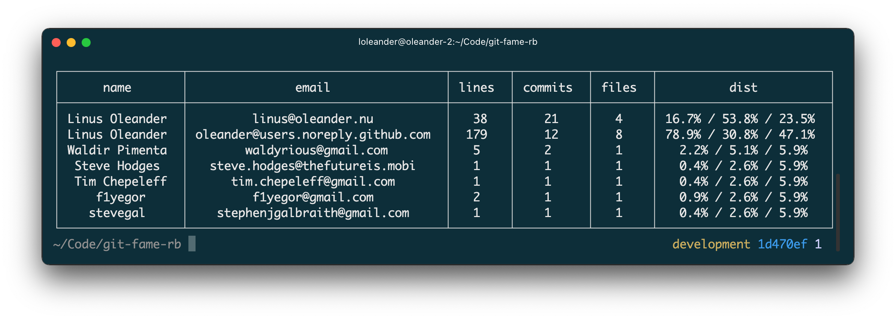

# git-fame [](https://github.com/oleander/git-fame-rb/actions/workflows/main.yml) [](https://rubygems.org/gems/git_fame)



`git-fame` is a command-line tool that helps you summarize and pretty-print collaborators, based on the number of contributions.

The statistics are mostly based on the output of `git blame` on the current branch.
`git fame` counts the total number of current lines of code (and files) that were last touched by each author, and prints out these totals, along with the number of commits per author, as a sorted table.

## Installation

`gem install git_fame`

Requires Ruby 3.2 or later. The `rugged` dependency compiles libgit2 during installation, which needs [CMake](https://cmake.org) (`brew install cmake`, `apt-get install cmake`).

## Usage

``` shell
Usage: git fame [OPTIONS] [PATH]

GitFame is a tool to generate a contributor list from git history

Arguments:
  PATH  Path or sub path to the git repository

Options:
  -A, --after [DATE]       Only changes made after this date
  -B, --before [DATE]      Only changes made before this date
      --branch [NAME]      Branch, tag or commit to be used as starting point
                           (default "HEAD")
  -E, --exclude [GLOB]     Exclude files matching the given glob pattern
  -e, --extensions [EXT]   File extensions to be included starting with a
                           period
  -h, --help               Print usage
  -I, --include [GLOB]     Include files matching the given glob pattern
      --log-level [LEVEL]  Log level (permitted: debug, info, warn, error,
                           fatal)
  -v, --version            Current version

Examples:
  Include commits made since 2010
  git fame --after 2010-01-01

  Include commits made before 2015
  git fame --before 2015-01-01

  Include commits made since 2010 and before 2015
  git fame --after 2010-01-01 --before 2015-01-01

  Only changes made to the main branch
  git fame --branch main

  Lines as of a tag or commit
  git fame --branch v1.0.0

  Only ruby and javascript files
  git fame --extensions .rb .js

  Exclude spec files and the README
  git fame --exclude '*/**/*_spec.rb' README.md

  Only spec files and markdown files
  git fame --include '*/**/*_spec.rb' '*/**/*.md'

  A parent directory of the current directory
  git fame ../other/git/repo
```

Use `git fame -h` or `git-fame --help` for this text. Git turns `git fame --help` into `git help fame`, which looks for a man page that does not exist.

Quote glob patterns, as in the examples, so the shell passes them to `git fame` instead of expanding them.

### What is counted

`git fame` blames every text file in the given branch, tag or commit (`HEAD` by default). Binary files and submodules are skipped.

- `lines`: lines in those files that the author changed last.
- `commits`: commits by the author that are still the last change to at least one line.
- `files`: files with at least one such line.
- `dist`: the author's share of all lines, commits and files. A file with lines from several authors counts for each of them, so the file shares can add up to more than 100%.

Authors are told apart by email address.

## Development

1. `git clone https://github.com/oleander/git-fame-rb.git`
2. `docker build -t git-fame -f .devcontainer/Dockerfile .`
3. `docker run -it -v $(pwd):/workspace git-fame bundle exec rspec`

Have a look at `.devcontainer/Dockerfile` and `.github/workflows/main.yml` for more information.

## New release

1. In a pull request, bump the version in `lib/git_fame/version.rb` and move the `Unreleased` entries in `CHANGELOG.md` to a section for that version.
2. Merge the pull request. Once CI passes on `main`, the `release` job tags the merge commit as `vX.Y.Z`, creates a GitHub release from the changelog section and publishes the gem to RubyGems.

Pushes to `main` that leave the version unchanged publish nothing.
